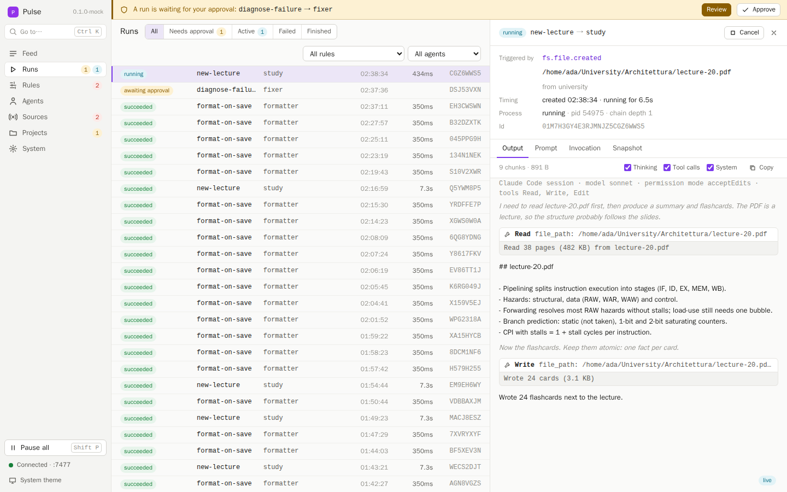

# Agents and permissions

An **agent** is a named identity: how to start it (its **adapter**), where it works, and which
events it may hear about (its **scopes**). A rule wakes an agent; the same agent can serve
several rules. Pulse never runs a model itself: it starts the agent's own program.

```toml
[[agent]]
name = "study"
adapter = "claude-code"
allowed_tools = ["Read", "Edit(./**)"]
cwd = "~/University"
allow = ["fs.file.created:~/University/**"]
timeout = "15m"
max_concurrent = 1
max_queued = 20
```

Add one from the UI (**Agents → New agent**), the config file, or a file with the same keys:

```sh
pulse agents add --file study.toml     # or - for stdin; replaces an agent of the same name
pulse agents                           # list (same as pulse agents list)
pulse agents show study                # its definition, as TOML
pulse agents remove study              # refused while a rule uses it
```

Every key: [config reference](config.md#agent).

## Adapters

| Adapter | Starts | Prompt goes to | Output shown as |
|---|---|---|---|
| `claude-code` | `claude` (or `program`) | stdin | assistant text, one-line tool calls, tool results, errors, the final result |
| `codex` | `codex exec` (or `program`) | stdin | the same, from Codex's JSON events |
| `command` | any argv you configure | stdin (or the event, or nothing: `stdin`) | stdout and stderr lines |
| `mcp` | nothing | | an identity for an MCP client; see [MCP](mcp.md) |

### What Pulse passes to the agent

Nobody can answer a permission prompt in a run triggered at 3 a.m. by a file appearing. So the
two coding-agent adapters always pass the most restrictive setting that **fails visibly instead
of hanging**, explicitly, so your interactive defaults never apply to event-triggered runs.

`claude-code` runs:

```
claude --print --output-format=stream-json --verbose --permission-mode=dontAsk
       --permission-prompts=none [--model=…] [--allowedTools=… …] [--disallowedTools=… …]
       [extra_args…]
```

`dontAsk` allows reads in the working directory and whatever `allowed_tools` pre-approves, and
denies everything else at once; the run's output then names every denied tool. To let the agent
write, pre-approve narrowly: `"Edit(./**)"` allows edits under its `cwd`; a bare `"Write"` allows
writing anywhere.

`codex` runs:

```
codex exec --json --sandbox=read-only --config=approval_policy="never" [--model=…] [extra_args…]
```

Writes fail inside the read-only sandbox and commands that would need approval fail; the model is
told. Codex refuses to run outside a git repository unless `extra_args` contains
`--skip-git-repo-check`.

Pulse never adds anything that skips checks (`bypassPermissions`, `--dangerously-*`,
`danger-full-access`). You can configure them; that is your explicit choice. The prompt, the only
place event content appears, goes to stdin and never into these programs' arguments.

These flags are **not a sandbox**. Claude Code still applies your settings files and those of the
working directory (allow rules, hooks), and Codex its config. A repository you use as an agent's
`cwd` brings its own `.claude/settings.json`.

### `command`

```toml
[[agent]]
name = "notify"
adapter = "command"
command = ["notify-send", "Pulse", "--", "{{subject}}"]
allow = ["fs.file.created:~/Downloads/**"]
```

The command is an array and is never run through a shell. Each argument is rendered on its own,
so event content can never add an argument or a command; the program (first element) cannot
contain placeholders. If an argument that **starts** with a placeholder would render to something
starting with `-` (a file named `--exec=sh`), the run fails before starting, unless an earlier
argument is exactly `--`. Put `--` before event values, as above.

The safest way for a script to read the event is the event file, not substitution:

| Variable | Value |
|---|---|
| `PULSE_EVENT_FILE` | path of the event as JSON (written by the daemon in the run's directory) |
| `PULSE_EVENT_ID`, `PULSE_EVENT_TYPE`, `PULSE_EVENT_SOURCE`, `PULSE_EVENT_SUBJECT`, `PULSE_EVENT_TIME` | the event's fields |
| `PULSE_EVENT_DATA` | the event's data as JSON (size-bounded) |
| `PULSE_RUN_ID` | the run; `pulse run` and `pulse ingest` inside it report exact causation |
| `PULSE_RULE`, `PULSE_AGENT` | names |
| `PULSE_CHAIN_DEPTH` | the run's position in a chain of runs |
| `PULSE_HOME` | so `pulse` commands inside the run reach this daemon |

Every adapter gets these. The run's environment is the daemon's, minus any `PULSE_*` variables
it had, plus the agent's `env`, plus the variables above.

## Runs

A run starts in the agent's `cwd`, or in a fresh `$PULSE_HOME/runs/<run id>/` when no `cwd` is
set. It is in its own process group. When it exits, times out (`timeout`, default 15 minutes) or
is cancelled, the whole group gets SIGTERM and then SIGKILL, so helpers it left behind are
cleaned up too. A process that leaves the group on purpose (`setsid`, daemons) escapes this; if
it still holds the output, the run's output says so.

States: `pending_approval` → `queued` → `running` → `succeeded`, `failed`, `timed_out`,
`cancelled`; `rejected` for a supervised run you refused; `interrupted` when the daemon stopped or
crashed while it ran (it is not restarted). `max_concurrent` runs execute at once per agent;
up to `max_queued` more wait. Output is kept up to 4 MiB per run (first half and latest output).

<picture>
  <source media="(prefers-color-scheme: dark)" srcset="../images/run-output-dark.png">
  
</picture>

*A run streaming its output: assistant text, a tool call (`Write`) and its result. Captured with
the stand-in agent the tests use.*

```sh
pulse runs list                         # newest first
pulse runs list --status running
pulse runs show <id>                    # event, prompt, invocation, timing
pulse runs logs <id> -f                 # output, following until it ends
pulse runs cancel <id>
pulse runs rerun <id>                   # same event and prompt, now; skips cooldowns and approval
```

## Scopes

`allow` decides which events an agent is told about, through rules and through MCP. **Default
deny**: an agent with no scopes receives nothing, and a rule that wakes it on an event it cannot
see is blocked as `permission_denied` ("it would need …").

| Scope | Covers |
|---|---|
| `"calendar.*"` | every calendar event |
| `"fs.file.created:~/University/**"` | files created under `~/University` |
| `"process.exited:~/code/**"` | wrapped commands whose working directory is under `~/code` |
| `"ext.ci.*"` | external events from the `ci` source |

A scope with a path covers an event only if the event carries at least one path and **every**
path it carries is inside the glob (a move counts its old path too; a `fs.burst` counts its
sample). Paths are compared as text: only clean absolute paths can be in scope (anything with
`.`, `..` or `//` is denied), matching is case-sensitive, and symlinks are not resolved. A
symlink inside a granted folder that points elsewhere is in scope by its name.

**What scopes are not.** They control what Pulse *tells* an agent. They do not limit what a
running agent can *do*: a Claude Code run told about `~/University` can still read `~/.ssh` if
its own permissions allow it. That is the agent runtime's job (its permission mode, sandbox and
allowed tools). Isolation and permissions are separate controls, and neither is a complete
safety boundary. See [the threat model](../internals/0003-threat-model.md).
