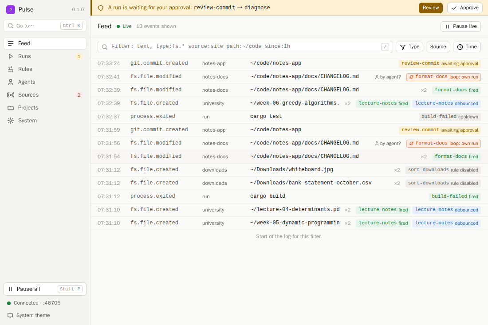

# The desktop app

The Lictory Pulse desktop app is a window, a tray menu and notifications around the same UI the daemon serves
to your browser. It is optional: the daemon does all the work and keeps running without it.

> **Status.** The desktop app has been run only on Linux arm64, under a virtual display (Xvfb),
> by its end-to-end tests. Its tray icon on real desktops, real notification delivery, the macOS
> `.dmg`, and x64 builds have **not** been verified by anyone running them. The packages are
> unsigned and there is no auto-update.

<picture>
  <source media="(prefers-color-scheme: dark)" srcset="../images/desktop-dark.png">
  
</picture>

*The window shows the daemon's own UI (captured on Linux under Xvfb).*

## Building it

`./scripts/build.sh` (without `--no-app`) builds the app for the machine you run it on:

- Linux: `apps/desktop/release/Lictory-Pulse-<version>-linux-<arch>.AppImage`
- macOS: `apps/desktop/release/Lictory-Pulse-<version>-mac-<arch>.dmg`

See [Getting started](getting-started.md#build) for prerequisites. The package contains the same
`pulse` binary as the headless build.

## What it does when it starts

1. It looks for a daemon already running on your Pulse home (`$PULSE_HOME`, default `~/.pulse`)
   and checks that it answers. If there is one, it uses it.
2. Otherwise it starts one with its bundled binary, as `pulse start --detach`. That daemon runs
   in its own process group and **outlives the app**.
3. It opens a window on the daemon's UI and signs it in with a single-use login code (the same
   mechanism as `pulse open`).

A daemon started from the app gets your login shell's `PATH` (so agents installed in
`~/.local/bin` or with Homebrew are found). A daemon you start from a terminal gets that
terminal's environment.

## Quitting

- **Quit Pulse** (menu, Cmd+Q, logout) closes the app. **The daemon keeps running** and keeps
  waking agents. That is deliberate.
- **Quit Pulse and stop the daemon** (tray and window menu) also stops the daemon, waiting for
  it to terminate its runs.
- `pulse stop` from a terminal stops the daemon; the app then shows "The daemon is not running"
  with a **Start the daemon** item. It does not restart it on its own.

**Closing the window** hides it to the tray where a tray icon is known to be visible: always on
macOS, and on Linux desktops whose panels show tray icons out of the box (KDE, Xfce, Cinnamon,
MATE, LXQt, Budgie, Ubuntu's GNOME session and others). On other Linux desktops (plain GNOME)
closing the window quits the app, since an invisible tray would strand it. The menu checkbox
"Keep running in the tray when the window closes" overrides this. `--hidden` starts the app with
no window.

## Tray and notifications

The tray menu shows the daemon's state, **Pause everything / Resume**, runs waiting for approval
(click to open one), recent runs, **Open Lictory Pulse**, **Install command line tool**, a notifications
switch, and the two quit items. The window's menu bar carries the same items, so they work where
no tray shows.

Notifications are raised for a run **waiting for approval**, a run that **failed or timed out**,
a rule **held by its circuit breaker**, and the **daemon going away** or failing to start. Not
for runs that start or succeed. At most three at once, then one per 20 seconds; the rest are
summarised. A single delivery blocked by loop protection is **not** notified (only a tripped
circuit breaker is); look in the feed or `pulse rules history`.

## The command line tool

**Install command line tool…** links `~/.local/bin/pulse` to the app's binary. It never
overwrites a `pulse` that is not such a link. By hand:

- macOS: `ln -s "/Applications/Lictory Pulse.app/Contents/Resources/bin/pulse" /usr/local/bin/pulse`
- AppImage: `./Lictory-Pulse-*.AppImage --appimage-extract`, then link `squashfs-root/resources/bin/pulse`.

## Platform notes

**macOS.** The app has only an ad-hoc signature, no Developer ID and no notarization, so
Gatekeeper blocks the first open. Drag Lictory Pulse to Applications, open it once, then System
Settings → Privacy & Security → **Open Anyway**; or run
`xattr -dr com.apple.quarantine "/Applications/Lictory Pulse.app"`. Do not run it from the mounted `.dmg`.
None of this has been tried on a Mac yet.

**Linux AppImage and the Chromium sandbox.** Chromium's OS-level sandbox needs unprivileged user
namespaces, which Ubuntu 23.10 and later restrict with AppArmor. The AppImage's launcher detects
that and starts the app with `--no-sandbox`. On a default Ubuntu 24.04 the window therefore runs
**without Chromium's OS sandbox**; the app's own protections (context isolation, no Node in the
page, navigation locked to the daemon, permissions denied) still apply, but a renderer exploit
would not be contained by the OS. The tray and window menus say "Running without the Chromium
sandbox (--no-sandbox)" when this happens. If that matters to you, use the UI in your browser
(`pulse open`) instead of the app.

Inside an AppImage the app copies `pulse` to its data directory before starting a daemon, because
the AppImage's mount disappears when the app quits.

Design record: [docs/internals/0010-desktop-shell.md](../internals/0010-desktop-shell.md).
