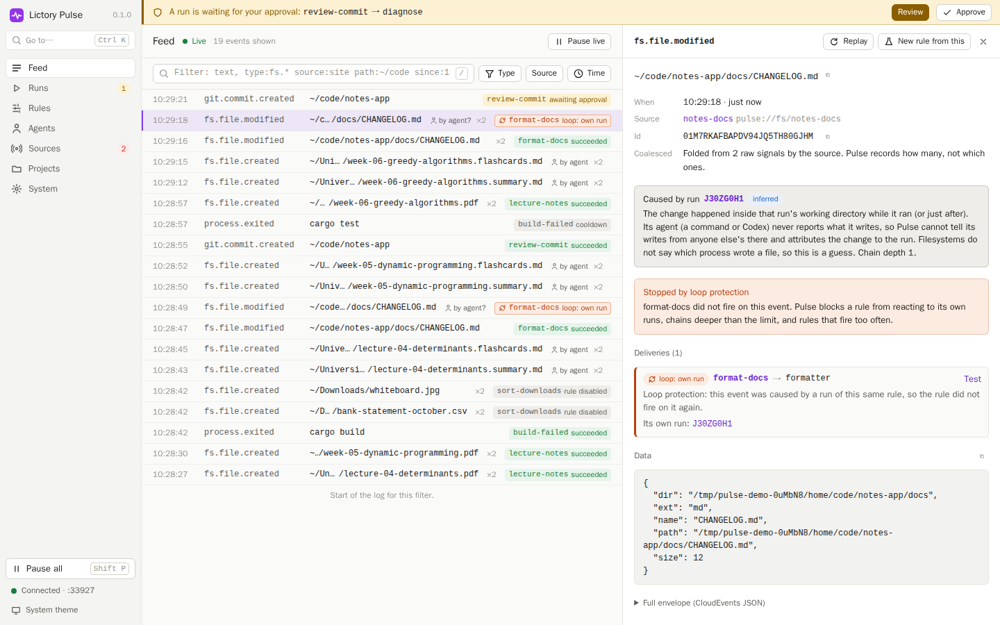

# Loop protection

An agent that writes a file into the folder its own rule watches would wake itself again, and
again. Pulse stops a rule from being triggered by its own run, and limits how long a chain of
runs triggering other runs can get. This page says how it decides, which part of that is a
guess, and what to do when it guesses wrong.

## The principle

1. Every event may carry a **cause**: the run believed to have produced it, and how Pulse knows
   (`exact` or `inferred`).
2. A rule never fires on an event caused by **its own** run. The delivery is recorded as
   blocked, `loop_self_trigger`.
3. Other rules may fire on it, but each run in a chain counts. A chain longer than
   `[limits] max_chain_depth` (default 3 runs) is blocked as `loop_chain_depth`.
4. Because the cause is sometimes a guess, there are backstops that do not depend on it at all:
   a rule's `cooldown` and `rate_limit`, and a **circuit breaker**: once a rule has fired 20
   times within 10 minutes, the next match trips it and the rule is held for an hour
   (`[limits.circuit_breaker]`). A held rule's matches are blocked as `circuit_open` until the
   time runs out or you unsnooze it.

Every blocked delivery is kept in the log. A stopped loop is visible, not silent.

## How Pulse knows who caused an event

> **This section describes attribution as it is in this version and is expected to change.**
> Everything else on this page is the stable principle.

- **Exact.** Every run has `PULSE_RUN_ID` in its environment. When the run calls `pulse run` or
  `pulse ingest`, the event it reports carries that run as its cause, marked `exact`. This is
  the only way a `process.exited` event gets a cause.
- **Inferred.** Filesystems do not say which process wrote a file. So while a run is active,
  and for `[limits] causation_grace` (30 s) after it ends, any file or git event **inside that
  run's working directory** (`cwd`) is attributed to it and marked `inferred`.

Inference is wrong in both directions:

- **It can miss.** An agent that writes outside its working directory is not attributed at all.
  The default working directory is a fresh `$PULSE_HOME/runs/<run id>/`, so an agent left at the
  default that writes into a watched folder by absolute path is never recognised; only cooldown,
  rate limit and the circuit breaker stop it. With the default breaker that is up to 20 runs in
  10 minutes, then an hour's hold. Cheap for a script, real money for a model. Give agents that
  write a `cwd` that contains what they write.
- **It can claim too much.** Anything that appears in the working directory during a run (or
  in the 30 s after) is taken for the agent's, including files you save yourself. With the
  `lecture-notes` template, whose `cwd` is the watched folder, a second PDF saved while the
  first is being summarized is blocked as a self-trigger.
- After a daemon crash, a run that was running counts as active until its timeout would have
  ended it (the agent survives in its own process group), so its folder's events are attributed
  to it for that long.

## Seeing a blocked delivery

In the UI, the feed marks the event with an orange-red **loop** badge, and the event's detail
says which run it was attributed to, whether that was exact or inferred, and the chain depth.

<picture>
  <source media="(prefers-color-scheme: dark)" srcset="../images/event-detail-dark.png">
  
</picture>

*An edit attributed (by inference) to the run of `format-docs`, so `format-docs` did not fire on
it.*

From the CLI, this is a `command` agent whose `cwd` is the folder its rule watches, and which
writes a copy of each new file there:

```console
$ pulse rules history copy-files
2026-11-16T10:20:50.715Z  copy-files           blocked: loop protection: the event was attributed to this rule's own run 01M7HXZAP64BNK835NXSXTP6MK  [event 01M7HXZCMVAMZHABKDGR2Z6QDP]
    if you made this change yourself: pulse replay 01M7HXZCMVAMZHABKDGR2Z6QDP
2026-11-16T10:20:48.710Z  copy-files           fired  run 01M7HXZAP64BNK835NXSXTP6MK  [event 01M7HXZAP64BNK835NXSXTP6MJ]

$ pulse events show 01M7HXZCMVAMZHABKDGR2Z6QDP
2026-11-16T10:20:48.715Z  fs.file.created /home/me/loop/one.txt.copy  (from run ~01M7HXZAP64BNK835NXSXTP6MK)  [01M7HXZCMVAMZHABKDGR2Z6QDP]
…
```

In the CLI's text output, `~` before a run id means the cause was inferred; no `~` means exact.
`--json` output has `pulsecausation: "inferred"` or `"exact"` on the event.

## Undoing a wrong block

If the change was yours, replay the event:

```sh
pulse replay <event id>                   # route it again to every rule
pulse replay <event id> --rule lecture-notes   # only to this rule
```

A replay is a new event with the same content and **no cause** (it is your request), so the
rule fires:

```console
$ pulse replay 01M7HXZCMVAMZHABKDGR2Z6QDP
Replayed as 01M7HXZJQ31E8CJ8S324ZBE9B7
2026-11-16T10:20:56.931Z  copy-files           fired  run 01M7HXZJQ31E8CJ8S324ZBE9B8  [event 01M7HXZJQ31E8CJ8S324ZBE9B7]
```

What that run writes is attributed to it in turn, so a replay does not start a loop.

If a circuit breaker is holding a rule, `pulse rules list` says `breaker open until …`, and
`pulse rules unsnooze <rule>` (or **Unsnooze** in the UI) closes it. The fires that tripped it
still count until they are older than the breaker's `window`, so the next match within that
window trips it again: find out why it fired so often before releasing it.

## Settings

| Setting | Where | Default |
|---|---|---|
| `max_chain_depth` | `[limits]` | 3 |
| `causation_grace` | `[limits]` | 30s |
| `max_fires`, `window`, `open_for` | `[limits.circuit_breaker]` | 20, 10m, 1h |
| `cooldown`, `rate_limit` | each `[[rule]]` | none |

Design and test record: [docs/internals/0002](../internals/0002-architecture.md#loop-protection)
and [0009](../internals/0009-end-to-end.md#loop-protection-as-observed).
