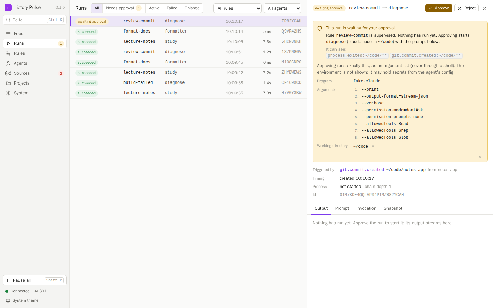
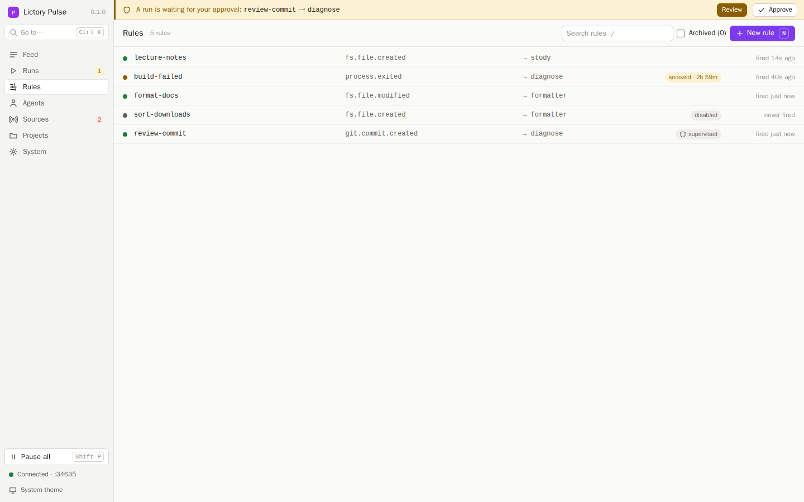

# Rules

A rule says: **when** an event matches, **wake** this agent with this prompt.

```toml
[[rule]]
name = "lecture-notes"
description = "Summarize each new lecture PDF and make flashcards from it."
on = "fs.file.created"
where = { path = "~/University/**/*.pdf" }
debounce = "10s"
debounce_by = "subject"
rate_limit = "20/hour"

[rule.run]
agent = "study"
prompt = """
A new lecture PDF was saved at {{path}}.
Read it, then write a summary and flashcards beside it.
"""
```

Every key: [config reference](config.md#rule).

## Where rules live

Rules are definitions in `pulse.toml`. The UI's rule editor, `pulse rules add`, and your text
editor all change that file; the daemon reloads it on save. History (what each rule decided)
lives in the database and refers to rules by name.

```sh
pulse rules list                 # active rules
pulse rules list --all           # archived ones too
pulse rules show lecture-notes   # definition (as TOML), file, state, last fire
pulse rules add --file rule.toml # add a new rule; - reads stdin
pulse rules add --replace -f rule.toml  # replace the rule of that name, whatever it is now
pulse rules remove lecture-notes # delete it from the file (history stays in the log)
```

`pulse rules add` takes the bare table that `pulse rules show` prints (`name = …`, `on = …`,
`[run]`). It only creates: if a rule of that name exists it says so and changes nothing. To
change one, `pulse rules show x > x.toml`, edit, `pulse rules add --replace -f x.toml`.

### Editing while something else edits

The file, the CLI and the UI can all change a rule while a rule editor is open. The editor
remembers which version it opened; if the rule changes meanwhile, it says so, lists what changed
(`enabled: true → false`), and saving is refused until you choose: **Reload** takes the rule as it
is now (dropping your edits), **Save mine anyway** replaces the current version with your form.
What you typed stays in the form either way, also if the rule is deleted meanwhile (then you can
create it again). Agents and sources behave the same. Enable/disable, archive/reopen and snooze
change only that one setting, so they never undo someone else's edit.

## Matching: `on` and `where`

`on` is an event type or a type glob, or a list of them. `*` matches across dots:
`"fs.*"` matches `fs.file.created` and `fs.burst`. The types are listed in
[Sources](sources.md) and in the UI's rule editor.

`where` narrows it. Every key must match:

```toml
where = { path = "~/University/**/*.pdf" }               # a path glob (starts with ~ or /)
where = { success = false, cwd = "~/code/**" }           # a boolean, and a path glob
where = { exit_code = { ne = 0 }, "data.command.0" = "cargo" }
where = { ext = ["pdf", "djvu"] }                        # any of
where = { size = { gt = 1000000 } }                      # operators
where = { source = "university" }                        # the source's name
```

Path globs (strings starting with `/` or `~`): `*` stays within one path segment, `**` spans any
number, `?`, `{a,b}`. Any other string is a plain text glob in which `*` also matches `/`, so
`path = "*.pdf"` matches every PDF anywhere (the rule's sources and the agent's scopes are what
limit where), while `path = "University/*.pdf"` never matches (event paths are absolute; Pulse
warns about it).

## Limits: debounce, cooldown, rate limit

- **`debounce = "10s"`** waits until matching events have stopped for 10 s, then fires once with
  the latest event. `debounce_by = "rule"` (default) keeps one timer for the whole rule: "lint
  once after a burst of edits". `debounce_by = "subject"` keeps one per subject: "summarize each
  new PDF once it has finished downloading". Pending debounces are **lost if the daemon
  restarts**.
- **`cooldown = "2m"`**: at least this long between fires.
- **`rate_limit = "10/hour"`**: at most this many fires per period.

A match held by a limit is recorded (`debounced`, `cooldown`, `rate_limited`), never silently
dropped. A debounce that ends during a cooldown waits for the cooldown instead of being lost.

A debounce that ends while the agent's queue is full (`max_concurrent` + `max_queued` runs
running or queued) **waits** for room: its delivery says `waiting: the agent's queue is full`,
and it fires as soon as one of the agent's runs ends, longest-waiting first. A burst of PDFs
larger than the queue is summarized one after another, not dropped. A newer matching event for
the same debounce replaces a waiting one, as it replaces a pending one. Waiting debounces count
toward `[limits] debounce_capacity`, and are lost if the daemon restarts, like pending ones.

A rule **without** a debounce whose agent's queue is full is `blocked` (`agent_busy`): nothing
holds the event, and the queue is the bound you set. If a burst should all be handled, give the
rule a `debounce` (with `debounce_by = "subject"` for one run per file) or raise the agent's
`max_queued`. `pulse replay <event>` runs a blocked one later.

## Supervised rules

`supervised = true` makes every run wait for you. The run is created as `awaiting approval` with
its prompt and its command already rendered, so you see exactly what the agent would be told and
what would be executed (the program and each argument, with the event's values filled in, and
the working directory); nothing starts until you approve, and what starts is what you saw.

```sh
pulse runs list --status pending_approval
pulse runs show <id>          # the event, the prompt, and the command it will run
pulse runs approve <id>
pulse runs reject <id> --reason "not now"
```

In the UI a banner shows waiting approvals on every page, with **Approve** and **Review**.
Approving needs the daemon token; an agent's own MCP credentials cannot approve anything.

<picture>
  <source media="(prefers-color-scheme: dark)" srcset="../images/approval-dark.png">
  
</picture>

*A supervised run waiting for approval: nothing has run yet; the prompt it would send is shown in full.*

## When a definition changes

A run remembers the rule and agent it was created with. It starts only if they are still the
same: if, before it starts (while it waits for approval or for a free slot), its agent is removed
or edited, its project is untrusted or changes, or its rule is removed, archived or given a
different prompt or agent, the run is **cancelled without starting**, and says why: "the agent
was removed or changed after this run was created; replay the event to run it with the current
definition". Approving such a run fails with the same reason. `pulse replay <event>` (or
**Replay** in the feed) routes the event again under the current definitions. Other rule changes
(its `where`, limits, `enabled`, `supervised`) do not affect a run that already exists.

`pulse runs rerun <id>` sends the run's stored prompt again with the agent as it is configured
now, and is refused if that agent no longer exists.

## Testing a rule against a past event

A dry run through the same routing code the daemon uses. Nothing is recorded and nothing runs.

```sh
pulse test-rule lecture-notes --event <event id>          # with the rule's current state
pulse test-rule lecture-notes --event <event id> --fresh  # as if it had never fired
pulse test-rule --file draft.toml --event <event id>      # an unsaved draft
```

It prints the decision and, if the rule would fire, the full prompt the agent would receive. For a
debounced rule it also says what happens when the debounce elapses. `--fresh` does not lift loop
protection: that comes from the event's recorded cause, and the output says how to replay the
event without it. In the UI, the rule editor
has the same tester beside the form (**Test**, Ctrl/Cmd+Enter).

## History: why did it fire, why didn't it

Every time an event matches a rule's `on` and `where`, Pulse records a **delivery**: what
happened and why. Events that do not match are not recorded per rule.

```sh
pulse rules history lecture-notes
pulse rules history lecture-notes --outcome blocked
pulse events show <event id>       # one event, every rule it reached, every run it caused
```

Outcomes: `fired`, `awaiting approval`, `debounced`, `waiting` (a debounced match held until
the agent's queue has room; a later line for the same event says what then happened), or
`blocked` with a reason: the rule is
disabled, snoozed, Pulse is paused, the agent's scopes do not cover it, loop
protection, the circuit breaker, cooldown, rate limit, the agent's queue is full, or the prompt
could not be rendered. See [Troubleshooting](troubleshooting.md).

## Replay

```sh
pulse replay <event id>                  # route a copy of the event again, to every rule
pulse replay <event id> --rule notes     # only to this rule
```

A replay is a new event (`pulsereplayof` points at the original) with no cause, so loop
protection does not hold it back. Use it after fixing a rule, or to undo a wrong loop block.

## Turning things off, and back on

Every way in has a way out:

| To | Do | Undo | Where it is kept |
|---|---|---|---|
| Turn a rule off | `pulse rules disable <rule>` | `pulse rules enable <rule>` | `enabled = false` in the file |
| Hold a rule for a while | `pulse rules snooze <rule> 1h` (or an RFC 3339 time) | `pulse rules unsnooze <rule>` | the database |
| Retire a rule, keep its history visible | `pulse rules archive <rule>` | `pulse rules reopen <rule>` | `archived = true` in the file |
| Stop everything | `pulse pause` | `pulse resume` | the database |

- A disabled or snoozed rule still records its matches as blocked, so you can see what it
  would have done.
- **Pause** stops every rule from firing (matches are recorded as blocked, "Pulse is paused")
  and holds runs already queued; they start on resume. Runs already running continue: cancel
  them with `pulse runs cancel`. In the UI: **Pause all** (Shift+P).
- `unsnooze` also releases a rule held by the circuit breaker, and the breaker counts from zero
  again (as it does when its hold runs out). The rule's `cooldown` and `rate_limit` still count
  the fires before it. If the cause is still there, the breaker trips again after `max_fires`
  more runs; fix the cause first.

<picture>
  <source media="(prefers-color-scheme: dark)" srcset="../images/rules-dark.png">
  
</picture>

*The rules list: a snoozed rule, a disabled one and a supervised one.*
