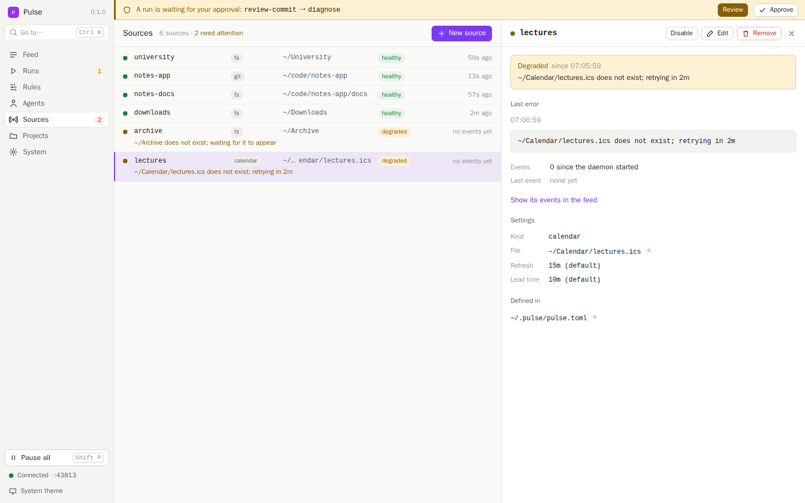

# Sources

A source watches one thing and turns raw signals into a few meaningful events. Four kinds are
built in: `fs`, `git`, `schedule` and `calendar`. Two more ways in need no source definition:
`pulse run` (a command's exit) and `pulse ingest` / `POST /ingest` (external events).

Add a source from the CLI, the UI (**Sources → New source**) or the config file; all three write
the same `[[source]]` table. Every key: [config reference](config.md#source).

```sh
pulse sources add fs university ~/University
pulse sources add git notes ~/code/notes
pulse sources add schedule morning --cron "0 9 * * 1-5"
pulse sources add schedule hourly --every 1h
pulse sources add calendar lectures ~/Calendar/lectures.ics
pulse sources                       # list them with their health
pulse sources remove hourly
```

## Health

`pulse sources` (and the Sources view) shows each source as `healthy`, `degraded` or `failed`,
with the last error and how many events it produced since the daemon started. Degraded means
it is working around something and says what: a folder that does not exist yet ("waiting for
it to appear"), a calendar URL that failed ("retrying in 2m"), the inotify watch limit, a kernel
queue overflow, file names that are not valid UTF-8 and were skipped. A missing folder or
repository is not an error: the source waits for it.

Failed means the source stopped: its settings are invalid, or it hit a problem it cannot work
around (or a bug in Pulse), and the message says which. A failed source is not retried on its
own; it starts again the next time the configuration changes (edit it, or re-add it) or the
daemon restarts.

<picture>
  <source media="(prefers-color-scheme: dark)" srcset="../images/sources-dark.png">
  
</picture>

*Two sources waiting for things that do not exist yet: a folder ("waiting for it to appear") and
a calendar file ("retrying in 2m").*

## `fs`: a directory tree

| Event | When |
|---|---|
| `fs.file.created` | a file appeared and has stopped changing |
| `fs.file.modified` | an existing file changed and has stopped changing |
| `fs.file.deleted` | a file was removed |
| `fs.file.moved` | a file was renamed or moved inside the tree (`from` and `path`) |
| `fs.burst` | many changes under one directory, folded into one event |

Data: `path`, `dir`, `name`, `ext`, `size` (and `from` for moves). Every path is absolute.

**Changes settle before they are reported.** A path must be quiet for `quiet` (default 2 s)
before its net effect is reported: a file created and then written for three seconds is one
`fs.file.created`; an editor's atomic save (write a temp file, rename it over the original) is
one `fs.file.modified`; a file created and deleted within the window is nothing. A file that
never goes quiet (a growing log) is reported every 5 minutes anyway. Downloads in progress
(`.part`, `.crdownload`, `.download`, …) are ignored, and the final file is reported once the
download completes.

**A storm becomes one event.** When more than `burst_threshold` (default 200) changes are
pending under one directory, they fold into a single `fs.burst` with counts and a sample of 8
paths:

```json
{ "dir": "/home/me/University/dataset", "count": 10000, "created": 10000,
  "modified": 0, "deleted": 0, "sample": ["/home/me/University/dataset/part00/0001.csv", "…"] }
```

Unzipping 10,000 files into a watched folder gives one `fs.burst`, and an unrelated edit next to
it stays its own `fs.file.modified`. A storm with no net effect (a build that creates and deletes
temp files) emits nothing. Folding needs the changes to be pending *at the same time*: a slow
trickle of many files (a large archive on a slow disk) is reported file by file. Rules on busy
folders should use `debounce`.

**Ignored by default:** VCS internals (`.git`, `.hg`, `.svn`, `.jj`), dependency and cache
directories (`node_modules`, `__pycache__`, `.pytest_cache`, `.mypy_cache`, `.tox`, `.direnv`,
`.idea`, …), editor swap and backup files (`*.swp`, `*~`, `.#*`, `#*#`), `*.tmp`, OS metadata
(`.DS_Store`, `._*`, `Thumbs.db`), and download temp names. Add your own with `ignore`.

Symlinks inside the tree are reported as files and never followed. File names that are not valid
UTF-8 are skipped and counted in the source's health.

Limits: on Linux each directory takes one inotify watch, and the system limit
(`fs.inotify.max_user_watches`) is reported in the source's health with the command to raise it.
After a kernel queue overflow the tree is rescanned; deletions during the lost window are not
reported. A directory moved out of the tree produces no per-file deletions. On macOS (FSEvents)
this source has never been run.

## `git`: a repository

| Event | Data |
|---|---|
| `git.commit.created` | `repo, branch, sha, message, author` |
| `git.branch.switched` | `repo, from, to` |
| `git.merge.conflicted` | `repo, files` |
| `git.push.completed` | `repo, remote, branch, sha` |

The source reads the repository's reflogs and state files; it never runs `git` and never watches
the working tree, so a checkout that rewrites thousands of files is one `git.branch.switched`.
An amend is a new commit; a rebase reports no commits (and `git.merge.conflicted` if it stops on
a conflict); a fast-forward merge or pull reports nothing. Detached HEAD: `to` is the commit id,
and commits have `branch: null`. Worktrees and submodules are followed. History is not replayed
at startup. A push to a URL with no remote-tracking branch leaves no trace and is not seen.

## `schedule`: a timer

`schedule.fired` with `cron` or `every`, `scheduled_for`, and `late`. `cron` is five fields in
your local zone or `timezone`. On a daylight-saving change, a skipped time fires right after the
gap and a repeated time fires once. If the daemon was down (or the machine asleep) at a
scheduled time, it fires **once** for the latest missed time, with `late: true`; never a backlog.

## `calendar`: an ICS file or URL

`calendar.event.starting` fires `lead` (default 10 minutes) before an event; `calendar.event.ended`
when it ends. Data: `uid, title, start, end, location, minutes_until`. Recurring events,
exceptions, cancellations and time zones (IANA, Outlook's Windows names) are handled. Each
occurrence fires at most once per kind, even if it is moved; a fire up to 15 minutes late (after
a suspend or restart) still happens and `minutes_until` shows how late. A URL is re-fetched every
`refresh` (default 15 minutes) with caching headers; failures retry with backoff and show in the
source's health. A feed may redirect (up to 5 times), but not from https to http, and not to an
address on your machine or your local network unless the URL you configured is itself one (a
calendar on your NAS); the source's health then says which address was refused. Calendar URLs
are fetched directly: proxy settings from the environment (`HTTPS_PROXY`) are not used.

A calendar can come from someone else (a subscribed feed, an invitation), so the work Pulse does
for it is limited whatever it contains: at most 2,000 occurrences of one recurring event and
20,000 of the whole calendar in the window it looks at (about a day back to a day ahead), and a
fixed amount of computation per event and per calendar. A real calendar stays far below these:
an event that repeats daily since 2010 costs a few steps. If a calendar reaches a limit, the
source shows as degraded and says which event and which limit (`some occurrences are not read:
event "Standup" has more than 2000 occurrences …`); everything within the limits still fires. An
event longer than 366 days is read as 366 days long, and the source's last error says so.

## `process.exited`: wrap a command with `pulse run`

```sh
pulse run -- cargo test
```

runs the command as if you had run it (on a terminal it gets a terminal, colours and Ctrl-C
work), then reports a `process.exited` event: `command, cwd, exit_code, success, signal,
duration_ms, output_tail` (the last 8 KiB of combined output by default; `--tail-bytes` changes
it). `pulse run` exits with the command's exit code, and stays silent if the daemon is not
running. The event's source is `pulse://process/run` and its only path is `cwd`.

## External events: `pulse ingest` and `POST /ingest`

Anything else can send events. They are always typed `ext.<source>.<type>`:

```sh
echo '{"type":"deploy.finished","subject":"api","data":{"ok":true}}' | pulse ingest --source ci
# → an event of type ext.ci.deploy.finished
```

Each stdin line is one JSON object with `type` (required) and optional `subject`, `time` (RFC
3339), `data` and `dedupe_key`. Lines are sent as they arrive, so `tail -f build.log | … | pulse
ingest -s ci` streams. The source name is yours to choose; external sources are not declared in
`pulse.toml`.

Over HTTP, `POST http://127.0.0.1:7477/ingest?source=ci` with the daemon token accepts one
object, an array, JSON lines, or a CloudEvent (with `specversion`):

```console
$ curl -s -X POST "http://127.0.0.1:7477/ingest?source=ci" \
    -H "Authorization: Bearer $(cat ~/.pulse/token)" -H "Content-Type: application/json" \
    -d '{"type":"build.done","data":{"n":1}}'
{"accepted":["01M7HY2KS2SPHQQV256D0SGFY6"],"duplicates":0}
```

Both refuse a `type` in a built-in namespace (`fs.…`, `git.…`, `process.…`, `schedule.…`,
`calendar.…`, `pulse.…`), so an external sender cannot pretend to be a file appearing or a build
failing:

```console
$ echo '{"type":"fs.file.created","subject":"/etc/passwd"}' | pulse ingest -s ci
error: event 0: type: fs.* is a built-in namespace; external events are always ext.<source>.<name>, so name it something else (for example "ci.fs.file.created")
```

`POST /ingest` refuses unknown fields (usually typos). **`pulse ingest` currently does not:** it
drops them silently, so `{"type":"x","colour":"red"}` is stored as an event with no data. Put
your payload under `data`.

An event whose `dedupe_key` was already seen from the same source within `[limits] dedupe_ttl`
(10 minutes) is dropped and counted (`Ingested 0 events (1 duplicates dropped).`).

External events carry no paths Pulse can vouch for, so only a scope without a path (`"ext.ci.*"`)
covers them.

Design record: [docs/internals/0005-sources.md](../internals/0005-sources.md).
